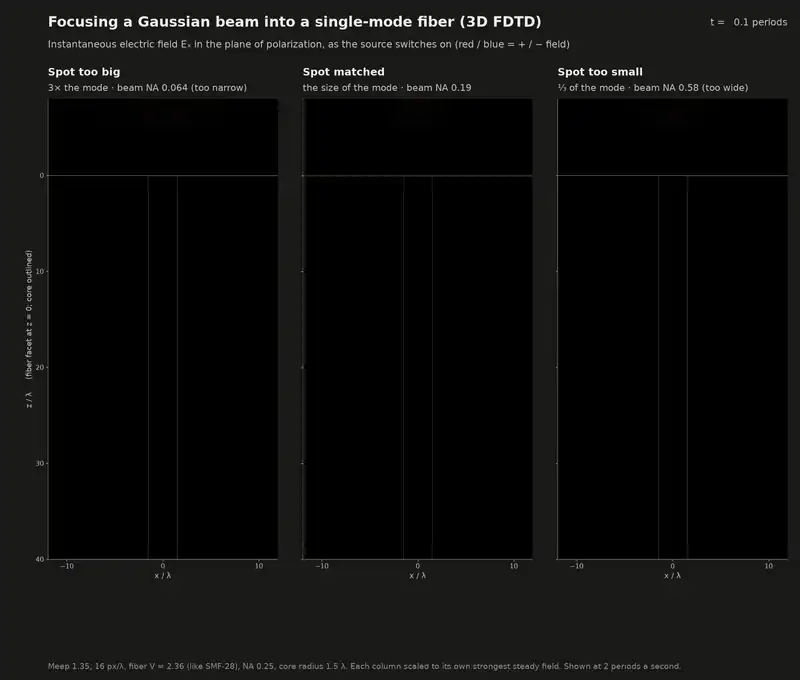
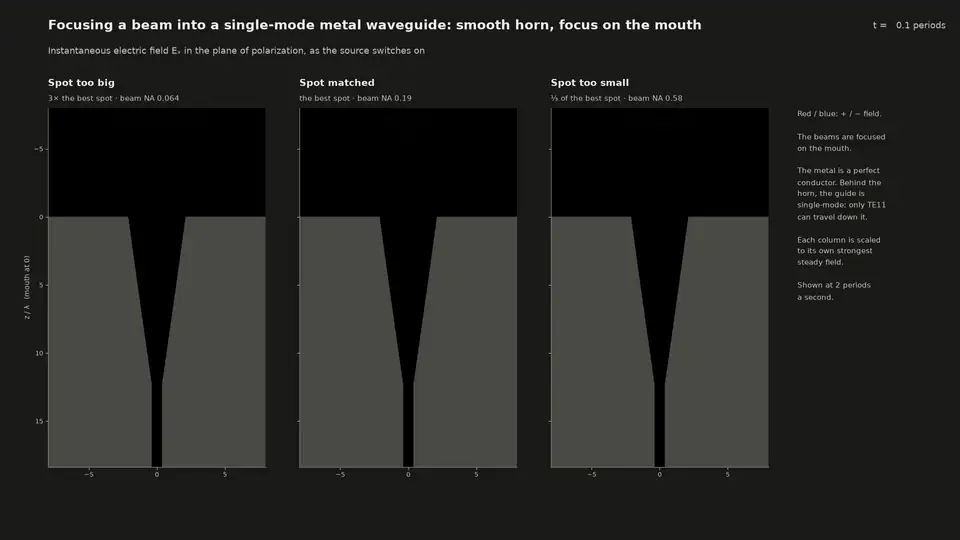

# Chat with Claude about launching light into a single-mode fiber with too narrow an NA

Every prompt is recorded here as it was typed, with minor typos fixed, followed by
the response. The simulations, scripts, movies and documents in this directory are what
the responses produced. Times are US Pacific.

## Prompt 1

> When light entering a fiber isn't mode matched, I know that not all of it gets launched
> down the fiber. If the incoming mode is too big, I can imagine that some of it gets into
> the cladding and fails to propagate. But what happens to the "rest" of light when NA into
> fiber is too narrow? Make 3D E&M sims and show me movies. Eventually I might want to check
> this into github, so make a git repo here with a README.md that shows the video near the
> top of the page and an MIT LICENSE and everything else. Take your time to do it right.
> Install locally any electromagnetic solvers and renderers that you need.

## Prompt 2

Sent while the first response was being built:

> Keep going, but record the initial prompt and other prompts in CLAUDE_CODE_CHAT.md along
> with your responses, just like you do for the PCB designs in ~/pcbs.

## Prompt 3

Also sent while the first response was being built:

> Keep going, but could you explain the "Mellanox InfiniBand cards were causing UCX probing
> issues"? Do I have something configured incorrectly? If not, just keep going.

Answered in passing: nothing is misconfigured. The two ConnectX ports run in Ethernet (RoCE)
mode and the locked-memory limit is 8 MB. That is fine for normal use, but UCX, the transport
layer under the MPI library, probes every RDMA device it finds, tries to pin memory on it, and
prints an error each time. Within one machine MPI only needs shared memory, so the runs set
`UCX_TLS=self,sm,tcp` (in `scripts/env.sh`) and never touch the cards.

## Prompt 4

Also sent while the first response was being built:

> Keep going, but between all of the "too narrow" and "too wide" plots and pictures needs to
> be a "just right" plot or picture for comparison.

Folded in: every figure and movie shows the three launches in the order too narrow, matched
("just right"), too wide. That includes the facet profiles, which had shown only the
too-narrow split, the long-distance side view, and the resolution study, which now runs the
too-wide launch too.

## Prompt 5

Also sent while the first response was being built:

> The processors are still being used 100%. What are you waiting for? If most things are in,
> do a review of the code and your results and make sure things make sense.

Answered in passing: the processors are busy with the 3D runs themselves (three launches at
about 3 hours each, then the NA sweep and the resolution study), so nothing was waiting.
The review was done while they ran: a check of the numbers so far against theory, and an
independent read of the simulation and analysis code by a separate Claude agent. It found
no error in the physics (mode projection, normalization, symmetry, reflection, units). It
did find things that changed reported numbers or labels, all fixed:

- the facet reflection at 16 px/λ is about 12% low (3.0% against the 3.4% it converges to),
  so the resolution study now extrapolates to infinite resolution and the README quotes both;
- the 10 and 12 px/λ convergence runs predated a fix to where the monitor planes sit on the
  grid, so they are being rerun;
- the long-distance (BPM) model scaled the fiber's size but not the coating's index step,
  which made the coating strip light too fast; the coating index is now scaled too;
- the long-distance model started 20 λ in, after some steep light had left the 3D window, and
  started from a slightly different guided/unguided split than the 3D simulation; it now starts
  5 λ in from exactly the 3D split;
- the FDTD effective index printed in the results includes the grid's numerical dispersion;
  corrected for it, it is 1.46105 against 1.46107 from the exact fiber-mode equation;
- smaller label and accounting fixes: the movie said every row had the same brightness scale
  when each had its own (since then every steady-state picture, the side views, the end of the
  movies and the 3D render, shares one scale per watt of incident light, and the field rows say
  they are scaled separately), the field colours were described backwards, light that had only left
  the simulated window was called "escaped" or "radiated", the same four destinations of the
  light had different names in different figures, and the beam in air was drawn as uncoupled
  light. It is now white.

## Prompt 6

Also sent while the first response was being built:

> In the simulations, can we see enough to see that the light that doesn't make it into the
> core doesn't just go into the cladding, but that it dies away before making it to the other
> side of the simulated cladding? Or would that take a much longer simulation?

Answered in passing: not in the 3D simulation, and that is part of the answer. Nothing in the
cladding glass absorbs. The uncoupled light dies only where it crosses the cladding surface
into the higher-index coating. In 120 λ of fiber (0.6 mm of SMF-28) the too-narrow launch's
uncoupled light is still 57% of the incident power. It has spread from a radius of about 6 λ
to 12 λ (holding 90% of it) and has not reached the real cladding surface at 23 λ. The 3D
window has no cladding surface at all: the glass runs into the absorbing boundary at 14 λ, so
light that reaches it is counted as "gone sideways". The long-distance model, which has the
whole cladding and the coating, shows the stripping. 1% of the uncoupled light is gone by
165 λ, half by 1330 λ (0.6 cm of SMF-28) and three quarters by 3590 λ (1.7 cm). At 2.9 cm, 9%
of the incident power is still in the cladding, falling by 1/e every 2.7 cm. A 3D simulation
long and wide enough to show half of it stripped would cost about 500 times the 3-hour run
and several hundred GB of memory.

## Prompt 7

Also sent while the first response was being built:

> This is fine, as long as your writeup makes it clear **with pictures** what the scales for
> each of the simulations are. Maybe make a telescoping series of plots that visually expands
> or shrinks the previous one.

Folded in: `media/scales.png` (`scripts/fig_scales.py`) zooms out from the facet in four
steps, each panel drawn as a box inside the next with zoom lines between them:

1. the actual wavefronts over the first 16 λ;
2. the whole 3D simulation at its true aspect ratio, inside the real cladding it leaves out;
3. the long-distance model over 6000 λ (2.9 cm), with the coating;
4. a 1 m patch cord.

The README shows it at the start of the results, with a table of what each simulation covers.

## Prompt 8

Also sent while the first response was being built:

> When you're all done, remake all the plots. The "too wide" and "too narrow" labels seem
> backward. Try "too small" and "too big" for the beam itself as it touches the fiber tip.
> That naming is much more intuitive.

Folded in: every figure, movie and the 3D render now names the launches by the spot on the
fiber tip: "Spot too big", "Spot matched", "Spot too small", with the size relative to the
mode and the beam NA underneath (for example "3× the mode · beam NA 0.064 (too narrow)"). The
README keeps the original question as its title and says once, in section 1, that a launch NA
that is too narrow is a spot that is too big; after that it uses the spot names.

## Prompt 9

Also sent while the first response was being built:

> Then after you're totally done with the fiber, do a version of all three simulations where
> you couple into a metal microwave wave-guide tube instead of a fiber. The dimensions
> relative to the wavelength should be similar. The answer to my question, "Where does the
> light go that doesn't enter in the correct mode?" must be different for the thick metal
> wave guide. There is no cladding. So if the wave guide is truly single mode, and the metal
> is perfectly conducting, the only way not to go in is to reflect. Compare and contrast these
> situations.
>
> I don't know how you want to set up the incoming microwaves to be either matched, focused to
> a spot that's too small, or focused to a spot that's too big. You could just make these the
> initial conditions. I don't know how much you need to acknowledge that such a mismatch comes
> from a mismatched horn or parabolic dish.

To be done after the fiber work is finished; see Response 2.

## Response 1 2026-10-27 10:09 - 2026-10-28 04:05 Claude Opus 5.5

*Prompts 2 to 8 arrived while this was being built; each is folded in, as noted under it.
Prompt 9, the metal waveguide, is Response 2.*

**The answer.** The light that a too-narrow launch fails to couple goes forward, into the
cladding, and stays there for a surprisingly long way. A launch NA that is too narrow is a
focused spot that is too big for the fiber's mode. Only the part of the incoming field with the
mode's shape is guided (38% for a spot 3× too big). The rest (59%) is neither reflected nor
scattered at the facet: it enters the glass as a broad beam around the core, almost all of it
inside the core's acceptance cone, and travels beside the core without ever joining it. It leaks
out through the coating slowly. In SMF-28 terms half of it is gone after 6 mm, but a sixth is
still in the cladding after 3 cm. A spot 3× too small (NA too wide) loses about as much, but at
steep angles, and that light is gone within a few millimetres.

### What was done

1. **Tools**, installed locally in two micromamba environments (`environment.yml`,
   `environment-render.yml`): Meep 1.35 (FDTD, with its MPB mode solver, MPI build) for the
   simulations, and PyVista on an off-screen VTK for the 3D render. They are separate because
   Meep's MPI build of HDF5 conflicts with VTK's.
2. **The fiber**: SMF-28's V number (2.36) in units of the wavelength, shrunk across by 1.76
   with the NA raised by the same factor. That keeps the mode's shape and every coupling number
   and makes the 3D volume 10× smaller (`fiberlaunch/params.py`, `fibermode.py`).
3. **3D FDTD** (`fiberlaunch/fdtd.py`): the three launches into 120 λ of fiber at 16 px/λ
   (about 3 h each on 16 cores), six more NAs into 10 λ of fiber, and a resolution study at
   10, 12, 16 and 20 px/λ. The beam is Meep's exact focused Gaussian, not a paraxial one.
4. **Analysis** (`fiberlaunch/analysis.py`): the field projected onto the fiber's HE₁₁ mode at
   every cross-section, the power budget, the angles of the uncoupled light, and an exact
   (non-paraxial) coupling estimate to check the simulation against.
5. **Long distances** (`fiberlaunch/bpm.py`): a beam-propagation model of the whole cladding
   and an absorbing coating, started from the 3D field 5 λ inside the facet and run to 6000 λ
   (2.9 cm of SMF-28).
6. **Media**: the turn-on movie (above), a 3D volume render, a fly-through of the
   cross-sections, the long-distance movie, and the figures in the README, among them the
   zoom-out of the scales (Prompt 7) and the facet profiles.
7. **The repository**: `README.md`, an MIT `LICENSE`, a `Makefile` that rebuilds everything,
   unit tests (`tests/`), and `.gitignore` for the 10 GB of raw data.

| | spot too big (NA 0.064) | matched (NA 0.19) | spot too small (NA 0.58) |
|---|---:|---:|---:|
| in the core mode, 3D FDTD | 38.2% | 96.4% | 37.7% |
| uncoupled, still near the core at 115 λ | 57.4% | 0.1% | 6.2% |
| uncoupled, gone sideways by 115 λ | 1.3% | 0.3% | 52.7% |
| reflected by the facet | 3.0% | 3.2% | 3.4% |
| still in the cladding after 2.9 cm (BPM) | 9.3% | 0.02% | 0.1% |
| exact focused-beam estimate of the coupling | 38.1% | 96.1% | 37.5% |
| coupling, extrapolated to an infinitely fine grid | 38.0% | 96.0% | 37.4% |

### Along the way

- **The review** asked for in Prompt 5 found no error in the physics but changed several
  numbers and labels; the list is under Prompt 5.
- **The 3D render** first came out too dim, and its opacity setting did nothing. VTK's GPU
  volume mapper ignores the opacity unit distance for colour-and-opacity volumes, and the CPU
  mapper that honours it draws visible steps. The render stays on the GPU mapper, with its
  opacity response measured and the opacity curve set to suit it, and jittered rays against
  banding.
- **The labels** changed to the spot on the fiber tip (Prompt 8), and every figure, movie and
  the 3D render were remade with them.
- **Resolution.** The resolution study finished last: from 16 to 20 px/λ the coupling moves
  by at most 0.15% of the incident power, and extrapolated it agrees with the exact
  focused-beam estimate to 0.2%. The facet's reflection converges slowly: 3.0 to 3.4% at
  16 px/λ, 3.4 to 3.8% extrapolated.

Not committed yet: the repository is initialized, and its first commit comes after Response 2.

## Response 2 2026-10-28 04:05 - 2026-10-28 09:07 Claude Opus 5.5

**The answer.** As you expected, in a single-mode, perfectly conducting guide the light that
is not coupled comes back, all of it. Guided plus reflected is 100% to within 0.01% in all
three simulations. What changes with the launch is where it turns back:

- **Spot too big** (a horn too small for its dish, which antenna engineers call *spillover*):
  70% of the power lands on the metal face around the horn's mouth and is reflected there.
  24% reaches the guide.
- **Spot too small** (a horn too big for its dish, *under-illumination*): 99% goes into
  the mouth, but as the horn's higher modes, because a small spot is a wide cone of directions.
  The horn narrows, each of those modes reaches its cut-off and turns back there, and
  75% of the power comes back out of the mouth. 24% reaches the guide.
- **Matched:** 80% reaches the guide. A smooth horn's mouth field is close to a Gaussian
  but not equal to one, so the matched beam, too, puts 16% into higher modes that turn back
  inside the horn.

So the coupling numbers are much like the fiber's (an overlap with the mode either way), but the
rest of the light goes the opposite way. The fiber's cladding is a continuum of forward-going
states that are not guided; the metal guide has only its modes, and they carry nothing below
cut-off, so the only state left is the incoming one reversed.

### What was done

1. **Why a horn.** A metal pipe is single mode only while it is less than 0.77 λ across, so it
   cannot be the size of the fiber's core; its mode is also smaller than any spot a beam can be
   focused to. A guide like that is fed through a horn. Here the horn is a smooth 8° cone cut into
   a thick metal block, 12.4 λ long, opening from the guide's radius (0.36 λ, only TE₁₁
   propagates) to 2.1 λ at the mouth. Its best Gaussian (1.60 λ waist) is within 0.1 point as
   good as the fiber's matched beam (1.66 λ), so the same three beams are matched, too big and too
   small for both. The README explains how a dish's f/D sets the spot, and how spillover and
   under-illumination map to "too big" and "too small".
2. **The beams.** Rather than starting them as initial conditions, each beam is radiated forward
   by a plane of equivalent electric and magnetic currents 4 λ in front of the mouth (the same
   exact focused Gaussian as in the fiber runs), and the run continues until it is steady. Every
   number is then a ratio of steady powers, and the movie still shows the beam arriving.
3. **The simulation.** The first version used a 3D Cartesian grid and could not converge: Meep
   cannot smooth a perfect conductor below the pixel, so the cone's wall became a staircase that
   scattered TE₁₁ into other modes (the matched coupling came out as 41, 55 and 69% at 16, 20
   and 28 points per wavelength). Since the horn, the guide and the beam share an axis, an
   x-polarized beam is exactly half angular order m = +1 and half m = −1. Meep's cylindrical mode
   solves the full 3D Maxwell equations for one angular order on the (r, z) plane, so the
   production runs are exact 3D at 2D cost: 120 points per wavelength, about 5 hours
   per launch on 5 cores (`fiberlaunch/horn.py`), plus a run of each beam with no metal for the
   incident power.
4. **Counting modes** (`fiberlaunch/horn_analysis.py`). A cone's modes are spherical waves
   about its apex, so the field is taken on spherical caps centred there, one per depth, and each
   mode's power heading in and heading back out comes from Lorentz reciprocity against the same
   mode going the other way. That separates the two directions exactly. Sent out from the guide,
   TE₁₁ comes back as 98.6 to 99.8% TE₁₁ on every cap.
5. **Checks.** The coupling also follows from a single run in reverse (TE₁₁ sent out of the
   guide, overlapped with each beam), done at 20, 40, 60, 80 and 120 points per wavelength and
   extrapolated to an infinitely fine grid (`scripts/horn_design.py`). It agrees with the direct
   runs, and the textbook aperture estimate (TE₁₁ filling the mouth on a spherical wavefront)
   agrees too.
6. **Media and README.** A movie of the three launches into the horn, the steady state on the
   plane of polarization, the power in each of the horn's modes against depth, and bars of where
   the power goes in the fiber and in the metal guide side by side; a new README section with all
   of it and a comparison table; `make horn` and `scripts/run_horn.sh` to rerun it.

| | spot too big (NA 0.064) | matched (NA 0.19) | spot too small (NA 0.58) |
|---|---:|---:|---:|
| **into the guide's mode (TE₁₁)** | **24.0%** | **80.2%** | **23.7%** |
| reflected by the metal face around the mouth | 70.3% | 4.0% | 0.8% |
| entered the horn, turned back inside it | 5.7% | 15.8% | 75.4% |
| coupling, one reverse run, extrapolated | 24.0% | 81.2% | 23.9% |
| aperture theory | 24.2% | 82.1% | 24.9% |
| *the fiber, for comparison: into the core mode* | *38.2%* | *96.4%* | *37.7%* |
| *the fiber: uncoupled, forward into the cladding* | *58.7%* | *0.4%* | *58.9%* |

### Along the way

- **The Cartesian staircase** (point 3) showed up only in the resolution series, as a coupling
  that kept climbing; that version is kept as `fiberlaunch/horn_cartesian.py`, and the README
  says why it was replaced.
- **Counting modes on flat planes** gave noisy, unphysical curves: inside a cone the wavefronts
  are curved, and a flat cut mixes the directions. Moving to caps about the apex fixed it.
- **The beam-in-air runs** first used the horn runs' long settling time; they were stopped and
  rerun with a time to suit an empty box.
- **The return loss.** The horn is well matched to the guide: TE₁₁ sent out of the guide has
  less than 0.1% of its power reflected back. So a network analyzer on the guide sees a good
  antenna, and a mis-focused beam shows up only as lost gain.
- **A dip that was the grid.** In a 40 px/λ trial the matched beam's TE₁₁ heading in seemed to
  lose 20 points halfway down the horn and win them back. At 120 px/λ it moves by only ±3
  points, near the cut-offs; the README explains what is left of it.

Committed as the repository's first commit, on `main`, not pushed: the code, the README, the
media (23 MB) and this chat log. The 13 GB of raw simulation output is left out by
`.gitignore`; `make sims` regenerates it.

## Prompt 10

> To the extent that these numbers are true and can be trusted, all of this information is
> great. Looking at all of the pictures, let me make a few high-level, qualitative statements,
> and you can critique them based on the data:
>
> * In both the metal wave guide and fiber cases, the "too small" case is a problem *not*
>   because the entire beam entering the circular aperture is too small, but that simply by
>   diffraction, a small beam eventually becomes a bigger beam.... and that bigger beam either
>   gets into the cladding and gets lost (for the fiber case), or reflects off of the metal and
>   makes its way back out (for the metal wave guide case).
> * The fiber can be more efficient for the "just right" size because the mode of the fiber is
>   better matched to an incoming Gaussian, whereas the mode of the waveguide or the mode of the
>   horn is less well matched to the incoming mode.

## Response 3 2026-10-28 11:35 - 2026-10-28 11:45 Claude Opus 5.5

**The first statement** is right for the fiber. For the metal guide it is right once "the
metal" means the horn's walls rather than its face.

- **The small spot does get in.** In the fiber it lands well inside the core. In the horn,
  99.4% enters the mouth and only 0.8% hits the face.
- **Spreading fast and being a wide cone of angles are the same fact.** The 0.55 λ spot's
  Rayleigh range is about one wavelength, so "eventually" is almost immediately. In the fiber,
  the steep part is beyond the core's NA, so total internal reflection does not hold it: 53%
  has left the 28 λ window by 115 λ, and the coating has absorbed 59% by 2.9 cm.
- **The split happens at the entrance, not after the beam spreads.** The whole beam does not
  grow and then partly get lost. The part with the mode's shape (38% in the fiber) stays
  mode-sized and travels on, and only the rest spreads. The coupling theory computed at the
  facet alone gives 37.5%, against 37.7% from the FDTD.
- **In the horn the light reflects off the walls, and the taper is what turns it back.** Metal
  reflects at any angle, so a straight pipe the size of the mouth would carry nearly all of what
  enters. In the cone, each bounce off the converging wall steepens a ray by 16° (twice the
  half-angle) until it heads back out. Each bounce also keeps the ray's closest distance to the
  cone's apex, because every tangent plane of a cone contains the apex, and the ray turns around
  at that distance. So only rays whose closest approach lies inside the throat (2.6 λ from the
  apex) get through. For a ray through the centre of the mouth that means within 10° of the axis
  (NA 0.17), close to the matched beam's 0.19. Counting rays this way gets the trend, though not
  the numbers, just as ray optics did for the fiber:

| rays / FDTD, % of the incident power | spot too big | matched | spot too small |
|---|---:|---:|---:|
| off the face | 70.0 / 70.3 | 4.1 / 4.0 | 0.0 / 0.8 |
| turned back inside the horn | 1.1 / 5.7 | 27.2 / 15.8 | 83.5 / 75.4 |
| reach the guide | 29.0 / 24.0 | 68.7 / 80.2 | 16.5 / 23.7 |

  Steeper rays turn around nearer the mouth, which is the ray version of higher modes being cut
  off nearer the mouth.

A tighter version of the statement: *a small spot is a wide spread of angles. The fiber keeps
only the angles within its NA; steeper light leaves the core sideways and is lost through the
cladding. The horn's walls keep every angle, but its taper steepens each bounce until the light
turns around, so whatever is steeper than about 10° goes back out of the mouth.*

"Too small" is no worse than "too big": it is the same mismatch, in angle instead of position.
The couplings are nearly equal (38.2 and 37.7% in the fiber, 24.0 and 23.7% in the horn), as
for two Gaussians 3× apart in size, which overlap by 36% whichever is bigger. All three beams
are diffraction limited, so a lens could turn either mismatched beam into the matched one
without loss.

**The second statement** is right, with one correction: what the beam has to match is the
horn's mouth field, not the waveguide's mode.

- **The fiber.** 96.4% couples and the facet reflects 3.2%, so 99.6% of the light entering the
  glass is in the mode. The fiber's mode is almost exactly Gaussian, and the only loss is the
  Fresnel reflection.
- **The horn.** 80.2% couples. The face reflects 4.0%, which is the Gaussian's tail beyond the
  mouth's radius (4.1% from the Gaussian formula). The same check holds for the too-big spot:
  70.0% of its power falls outside the mouth, and the face reflects 70.3%. The other 15.8% enters
  the horn but is not TE₁₁.
- **Why.** A TE₁₁ field on a flat mouth matches the best Gaussian only to 86.4%. The field stops
  at the metal wall, and TE₁₁ is not round: its width differs between the planes parallel and
  perpendicular to the polarization, and some of its field is cross-polarized. The 8° flare's
  curved wavefront, whose edge lags the centre by 0.15 λ, takes the match to 82.3%. The FDTD
  extrapolates to 81.2%.
- **The guide's own mode does not matter.** The horn converts it: TE₁₁ sent out of the guide
  arrives at the mouth 98.6 to 99.8% TE₁₁. A better horn closes most of the gap. A corrugated
  horn's walls make the field fade to zero at the wall in every direction (a "soft" wall in
  antenna terms, much as the fiber's mode fades into its cladding), and its HE₁₁ mode is about
  98% Gaussian. That is why quasi-optical systems and radio telescopes use corrugated feeds.

On how far to trust the numbers: the face reflection matches the Gaussian's tail outside the
mouth (70.3 against 70.0%, 4.0 against 4.1%), an independent check on top of the energy closure
(0.01%) and the reverse runs.

## Prompt 11

> Write up a brief summary of these things in README.md. I want a curious reader to find this and
> immediately see beautiful and clear illustrations and animations of what's going on at the top
> of the page, along with plots of where the light goes in all 6 situations. I don't expect people
> to read much text about this, so keep it short in README.md. You can point to a verbose study of
> how you got these results along with their details, but that should be a brief mention that is a
> link to the detailed file.

## Response 4 2026-10-29 23:55 - 2026-10-30 00:15 Claude Opus 5.5

- **`README.md`** is now short (66 lines) and leads with pictures:
  1. the two movies, the fiber and then the metal guide;
  2. one chart of where the light goes in all six cases;
  3. five one- or two-line points, summarizing Response 3;
  4. the 3D render and the long-distance movie;
  5. one paragraph linking to the details.
- **`STUDY.md`** holds the full write-up that was the README, with a link back. It also has a new
  section, "Why: wrong in position, wrong in angle, and the horn's mouth", with Response 3's
  reasoning: the ray picture and its table, and why the horn's mouth field is not Gaussian. The
  face-reflection check is added to the metal guide's checks.
- **The six-case chart** (`media/fiber_vs_horn_*.png`) labels each big segment in words, such as
  "57% forward, beside the core", "70% bounced off the face" and "75% turned back inside the
  horn". Each label's text is white or near-black, whichever contrasts more with its segment. The
  legend uses the same words.
- **`scripts/horn_estimates.py`** is new and writes `media/horn_estimates.txt`, which holds
  Response 3's quick estimates: the beam's power outside the mouth, the mouth field's match to a
  Gaussian, and the ray count. `make figures` runs it. Done with the exact case waists, the
  matched beam's power outside the mouth is 4.0%, not the 4.1% quoted in Response 3.
- **Checked:** every link and image in both pages resolves, and a rendered copy of the README
  reads in the intended order.

## Prompt 12

> I don't understand the phrase "wrong is position". For the fiber, isn't the have always at the
> focus? (So it's always at the correct position?) It's just that the focus can be tight or loose
> depending on numerical aperture? (Or equivalently the waist of the gaussian beam.)
>
> Are there horn tapers that would have matched better to incoming gaussian beams?

## Response 5 2026-10-30 06:40 - 2026-10-30 06:51 Claude Opus 5.5

**"Wrong in position."** You are right, and the phrase was a poor shorthand. In all six
simulations the beam is focused on the entrance and centred on the axis; only the spot's size
changes, and its spread of angles with it (w₀ = λ / (π · NA)). "Position" meant where across the
face the light lands, not where along the axis the focus is. Said better: **a spot too big
overfills the core, and a spot too small overfills the NA.**

- A spot 3× too big has a third of the mode's spread of angles, so every ray in it is shallow
  enough to be held, but 83% of its power lands outside the core.
- A spot 3× too small lands entirely on the core, but its spread of angles is 3× the mode's, and
  the steep part cannot stay.

Both beams, and the mode, are diffraction limited, so in a plot of position against angle each
covers the same area. A mismatched beam is that area stretched one way and squeezed the other, so
the two lose the same: 38.2% and 37.7% coupled in the fiber, against 36% for any two Gaussians 3×
apart in size. The overlap is the same whether it is computed across the face or across the
angles. What differs is the leftover light. The big spot's lies beside the core and runs nearly
parallel to it, so it lasts centimetres in the cladding. The small spot's starts on the core and
is steep, so it reaches the coating within millimetres.

**Is the focus at the right place?** For the fiber, yes. Its mode has a flat wavefront at the
facet, so a focus on the facet is best. For the horn it is not quite: the horn's wavefront at
the mouth is curved, centred on the cone's apex. Re-analysing the reverse runs (no new
simulation) for beams focused deeper, the best is a waist of 1.40 λ focused 3.7 λ inside
the mouth. It couples 85.5% at 120 points per wavelength, against 80.3% focused on the mouth.
This is the horn's "phase centre" in antenna terms.

**Better horns.** Yes. Computed here for mouth fields the size of this horn's, on a flat mouth:

| mouth field | best Gaussian w₀ | coupling |
|---|---:|---:|
| smooth wall, TE₁₁ (this horn) | 0.77 × the mouth radius | 86.4% |
| corrugated wall, HE₁₁ | 0.64 × the mouth radius | 98.1% |
| dual-mode (Potter), TE₁₁ + 16% of the power in TM₁₁ | 0.64 × the mouth radius | 98.4% |

- **Corrugated (scalar) horns** have grooves about λ/4 deep in the wall. These make the field
  fall to zero at the wall in every direction, so the mode is round, nearly free of
  cross-polarization, and close to J₀. They work over a wide band and are the standard feed on
  radio telescopes and in quasi-optics.
- **Dual-mode (Potter) horns** have smooth walls with a step near the throat that converts some
  TE₁₁ to TM₁₁. Arriving in phase at the mouth, TM₁₁ cuts TE₁₁'s field at the wall from 63% of the
  centre's to 14%, and its unround part from 8% of the power to 0.6%. The two modes travel at
  different speeds, so this works only over a narrow band. **Smooth spline-profiled horns**
  spread the conversion along a curved flare and widen the band.

A better horn raises only the matched case's ceiling. The too-big and too-small beams are
mismatched to any mode of the same size, so they would still couple at most about 36%.

**Changes:**

- **`README.md`**: the "wrong in position" point now reads "Too big overfills the core; too small
  overfills the NA", with a line saying every beam is focused on the entrance. The matched point
  mentions the focus inside the horn and the corrugated and dual-mode horns.
- **`STUDY.md`**: the "Why" section is renamed and rewritten the same way. It now covers the
  leftover light, the focus inside the horn and the better horns.
- **`scripts/horn_design.py`**: also finds the best focus depth for each reverse run and
  extrapolates it (`media/horn_design.txt`).
- **`scripts/horn_estimates.py`**: adds the corrugated and dual-mode mouth fields
  (`media/horn_estimates.txt`).

## Prompt 13

> Do another set of full simulations (with animations) for corrugated wall HE₁₁ and another set
> for the smooth horn with the beam at the optimal focus. Each set has the same focus position
> along z but different waists, I can't decide which situation is most analogous to the fiber
> coupling case. Also, remake the other horn simulations (and maybe the fiber ones too) to see
> more of the incoming beam. Maybe shift the box over (or make it a bit bigger if rhings are still
> changing at the right end) so that we can see at least twice as much incoming beam. I want to
> see that it's a converging gaussian beams in all cases.

## Response 6 2026-10-30 07:20 - 2026-10-30 22:47 Claude Opus 5.5

Work in progress; the runs take most of a day.

- **A corrugated horn** (`fiberlaunch/horn.py --wall corrugated`): the same 8° cone and mouth, its
  wall cut into 61 slots (0.15 λ wide, pitch 0.2 λ), a quarter wave deep by the radial line's exact
  resonance (0.26 λ at the mouth, 0.30 λ near the throat), with 6 slots near the throat stepping
  from half a wave to a quarter to turn TE₁₁ into HE₁₁. Sent out of the guide, TE₁₁ leaves its
  mouth 98% Gaussian (97.3, 98.2, 98.2% at 40, 60, 80 px/λ; a scan of converter length and slot
  depth at 40 moved it by at most 0.3 points).
- **The best focus** for each horn, from its reverse run: the smooth horn's best beam is 1.40 λ
  focused 3.7 λ inside the mouth, the corrugated horn's 1.28 λ focused 1.7 λ inside.
- **Three sets of three launches** (`params.HORN_SETS`): the fiber's own beams on the smooth
  horn's mouth (rerun), and for each horn, its best beam and beams 3× bigger and 3× smaller, all
  with that horn's focus. Each launch also runs with no metal, for the incident field.
- **More of the incoming beam:** the source plane is now 8 λ in front of the mouth or facet
  (it was 4 λ), and the horns' box is 18 λ in radius (14 λ), in all the horn runs and the six
  fiber runs, which are being rerun.
- **`STUDY.md`**: a new section, "Three sets of launches: which is like the fiber?", with the
  focused set's results; the corrugated ones to follow.

## Prompt 14

> You are still waiting on something, but the computer you're running on is at almost zero load.
> Is what you're waiting for done? Whenever you try to kill processes, you often kill other
> things unintentionally, so be very careful if you're going to do that.

## Response 7 2026-10-31 13:56 - 2026-10-31 14:57 Claude Opus 5.5

**Yes, it was done.** Everything had finished cleanly: the corrugated horn runs by 06:07 and the
six fiber runs by 12:45. I was waiting on a background loop that watched for the focused set's
movie to finish with `pgrep -f "horn_media.py --sets smooth_focus"`. That pattern also matched the
loop's own command line, so the loop never ended. I stopped only that loop, by its task ID; no
process was killed by name or pattern. Waits now check for an output file instead.

**The fiber, with the source 8 λ out:** 38.2 / 96.4 / 37.7% into the core mode (too big /
matched / too small), every number the same as before to within 5 × 10⁻⁴.

**The three sets of horn launches:**

| into the guide, % | spot too big | matched | spot too small |
|---|---:|---:|---:|
| single-mode fiber | 38.2 | 96.4 | 37.7 |
| corrugated horn, focused 1.7 λ inside | 34.3 | 98.0 | 35.0 |
| smooth horn, focused 3.7 λ inside | 31.8 | 85.4 | 41.4 |
| smooth horn, the fiber's beams on its mouth | 24.0 | 80.2 | 24.2 |

**Which is like the fiber: the corrugated set.** A fiber launch keeps the focus where the fiber's
mode has its own waist (on the facet, where its wavefront is flat) and changes only the waist. In
a horn, that point is where the horn's own beam has its waist, its phase centre, not the mouth.
The corrugated set is the one with both of the fiber's properties: a mode 98% Gaussian, and every
beam focused on the guide's waist. It also gives the fiber's pattern: nearly all of the matched
beam, and the same loss for 3× too big and 3× too small, close to the 36% overlap of two Gaussians
3× apart. The smooth sets mix in TE₁₁'s shape (15% even at the right focus, and it splits the
mismatched beams unevenly), and focused on the mouth, a 3.7 λ focus error as well.

**Converging beams.** A new figure, `media/incoming_simulated.png`, shows all nine beams as the
FDTD launches them with nothing in the way. The 1/e² radius measured from the field follows
Gaussian-beam theory for every one, and the wavefronts curve around the focus. The spot 3× too
big converges over its Rayleigh range of 46 to 78 λ, so over 8 λ its radius shrinks by only 0.4%;
`media/incoming_beams_*.png` shows it from 100 λ out.

**A meshing effect in the corrugated horn.** Its direct runs first disagreed with reciprocity by
0.4 to 1 point (0.15 or less for the smooth horn). The direct runs were steady (to 10⁻⁴, fitted
from the movie frames), the beam was right (the FDTD's own incident field gives the same overlap
as the exact beam), and the overlap did not depend on how far out it was taken. The two runs'
ε maps differed: the slots are 18 cells wide, so their edges fall exactly on cell boundaries, and
Meep's averaging there depends on floating-point rounding, which depends on where the box starts.
The reverse run's box started 4 λ nearer the mouth, and 15 of the 122 slot edges came out
differently by a fraction of a cell. Rerun on the launches' grid (identical ε, cell for cell), it
agrees with them to 0.13 points. That spread is the corrugated numbers' uncertainty at
120 px/λ, about ±1 point; `scripts/run_horn.sh` now puts that reverse run on the launches' grid.

**Changes:**

- **`fiberlaunch/params.py`, `fiberlaunch/horn.py`, `fiberlaunch/beam.py`**: the corrugated wall,
  the three sets, the source 8 λ out, and the beam a finite source plane actually launches
  (`beam.launched_spectrum`), which the reciprocity check now uses.
- **`scripts/fig_incoming.py`** (new): the incoming beams, in theory from 100 λ out, and as
  simulated (`media/incoming_simulated.png`).
- **`fiberlaunch/horn_analysis.py`, `scripts/horn_design.py`, `scripts/horn_media.py`**: either
  wall; the landing split of the reflected light; the guided field in any horn from the reverse
  run reversed in time; the 12-bar chart of the fiber and the three sets.
- **`README.md`**: the corrugated horn's movie (linking the smooth horn's two), the chart, and
  which set is like the fiber.
- **`STUDY.md`**: the converging beams in section 1; the three sets, with the answer; the checks
  for the corrugated horn, including the meshing effect; the numbers, timings and files.
- **All media regenerated** from the new runs; the 4 λ fiber runs are kept in
  `data/main/res16_source4`.

## Prompt 15

> The movies with the red and blue waves going into a horn or fiber are now annoying to watch
> because they blink rapidly. This is probably genuine interference forming a standing wave, but
> this makes them nearly unwatchable. If you have higher time-resolution data, one solution might be
> to just make the movie more frames and go slower. The launch_movie.mp4 and horn_movie.mp4 and
> corrugated_movie.mp4 and horn_focus_movie.mp4 files are particularly bad. In fact, these seem so
> undersampled in time that the wave inside of the waveguide looks like it's going backwards (like
> the famous wagon wheels in old movies).
>
> The launch_movie.mp4 also shows too much on the right side. Not much changes in the fiber. If you
> just showed the left half and spread it out to the full width of the movie, slowed it down, and
> only showed half the number of periods, it would be more informative.
>
> The cross_sections.mp4 should be shown first README.md and then long_distance.mp4 below it. Right
> now, only long_distance.mp4 is shown and it's hard to notice anything interesting happening in the
> "Spot too small" case, because all of the action happens right at the start, before people have
> even figured out what the movie is even about.

## Response 8 2026-11-01 07:21 - 2026-11-01 07:57 Claude Opus 5.5

**Why they blinked: the frames were too far apart.** The runs saved the field every 0.34 periods,
about three frames a period, and the movies played each saved frame once: 8 to 10 periods a
second. So a standing wave blinked at 8 to 10 Hz. A travelling wave moved a third of a wavelength
per frame, close enough to the wagon-wheel limit of half that it could seem to run backwards.

**No higher time resolution was saved, but it can be rebuilt.** The source has one frequency and
switches on over several periods, so at every point the field is Re[A(t) e^(−2πit)] with A
changing slowly. A quadratic A(t), fitted to the ten nearest saved frames, gives the field at any
time in between (`fiberlaunch/frames.py`). As a check, I left out each saved frame in turn and
rebuilt it from the others: it came back to within 0.12% of the steady field's peak, at any time,
in the fiber and the horns. That is about the float16 rounding of the saved frames. Rerunning
the simulations with more frames would have taken about two days for the same result.

**The movies now:** 15 frames a period, shown at 2 periods a second (4 to 5 times slower). A
standing wave now pulses smoothly at 2 Hz, and a travelling one visibly moves forward.

- **`launch_movie.mp4`** shows z = −8 to 56 λ across the full width, over the first 125 periods
  (half as many as before), by when that part of the fiber is steady to 0.5%. The picture is
  stretched 2.9× along z, which the axis label says. The power split moved to the right of each
  row's title, so the field uses the whole width. 68 s.
- **`horn_movie.mp4`, `horn_focus_movie.mp4`, `corrugated_movie.mp4`** run to 70 periods instead
  of 79 (steady to 2% by then). 41 s each.

**README:** `cross_sections.mp4` now comes before `long_distance.mp4`, with captions saying what
to look for in each.

**Previews:** the README's WebPs are larger now because the movies are longer: the fiber's
9.7 MB (800 px, 10 frames a second) and each horn's about 4 MB.

**Changes:**

- **`fiberlaunch/frames.py`** (new), with **`tests/test_frames.py`**: the frames in between.
- **`scripts/movie_turnon.py`**: the left half, full width, 125 periods, the budget in the title
  line, 2 periods a second.
- **`scripts/horn_media.py`**: the horn movies at 2 periods a second, to 70 periods.
- **`scripts/make_previews.sh`**: preview size and frame rate per movie.
- **`README.md`**, **`STUDY.md`**: the movie captions, the cross-sections movie, and a "Movie
  frames" check.

## Prompt 16

> I don't like the "stretched 2.9× along z". Id rather have the correct, physical aspect ratio.
> You can add more fiber to the right or change the aspect ratio of the movie. But keep the
> physics.

## Response 9 2026-11-01 08:18 - 2026-11-01 08:30 Claude Opus 5.5

**`launch_movie.mp4` is now at its true shape: x and z to one scale, 23 px/λ both ways.**
Stacking three rows across a 16:9 frame at one scale leaves room for either the whole fiber at
about 10 px/λ, which is mostly the unchanging right side, or a frame about 1920 × 2400 for the
first 56 λ. So I turned the fiber on end, as in the horn movies. The three launches are side by
side, the light comes down from the top, and each column is 24 λ wide (x = ±12 λ, as before).
The frame is 1920 × 1632, as tall as the columns need.

- **What it shows:** from the source plane, 8 λ out, to 40 λ into the fiber. That takes in the
  converging beam, the facet, and the too-small spot's light leaving the window sideways. It
  runs to 100 periods, by when that part of the fiber is steady to 0.1%. It is still 15 frames a
  period, at 2 periods a second: 55 s, then the steady-state picture.
- **The power split** is now four lines under each column, faded in at the end.
- **The README preview** is 800 px wide at 12 frames a second, 9.0 MB.

**Changes:** `scripts/movie_turnon.py` (the layout), `scripts/make_previews.sh`, and the
captions in `README.md` and `STUDY.md`.

## Prompt 17

> The README still only seems to show the "Further down the fiber" movie, not the other movie
> first.

## Response 10 2026-11-01 09:19 - 2026-11-01 09:19 Claude Opus 5.5

**The README on disk does have it,** in the section "In 3D, and further down the fiber": the 3D
render, then `cross_sections.webp` ("Flying down the fiber"), then `long_distance.webp`. The
preview is a valid 138-frame animation. But nothing has been committed since the first commit
(ca556d3), and that commit's README shows only the long-distance movie. A viewer that shows the
committed version (any git web view, or GitHub once pushed) therefore still shows the old README.
Committing would fix that.

## Prompt 18

> Also, for the "Where the light goes" plot on the README.md, don't bother showing the smooth horn
> plots. The animations only show the corrugated horn, so these bar-graph plots should only show
> that for comparison. Keep a version of this plot in the more detailed analysis.

## Response 11 2026-11-01 09:21 - 2026-11-01 09:23 Claude Opus 5.5

**The README's chart now shows only the fiber and the corrugated horn**, the horn its movie
shows: `media/fiber_vs_corrugated_{dark,light}.png`, six bars. The caption links to the full
chart, which STUDY.md keeps under "The fiber and the metal guide, side by side":
`fiber_vs_horn_*.png`, the fiber and all three horn sets.

The two charts come from the same function in `scripts/horn_media.py`. The legend now sits a fixed
distance below the axis; it used to be placed as a fraction of the plot's height, and in the
shorter chart it covered the axis label. The full chart is unchanged apart from that, and
`horn_results.json` comes out the same.

## Prompt 19

> Remove the README bullet about the smooth horn. Then commit what should be committed. I'll push
> to github and share this.

## Response 12 2026-11-01 09:28 - 2026-11-01 09:29 Claude Opus 5.5

Removed the README bullet comparing the fiber with the smooth horn. The corrugated-horn bullet
keeps the comparison that matters: 34 / 98 / 35% against the fiber's 38 / 96 / 38%. The smooth
horn's numbers stay in STUDY.md.

Committed everything since the first commit as one commit: the code, the tests, the docs, this
log and the regenerated media. The simulation output in `data/` stays out, as `.gitignore`
says (tens of GB; `make sims` remakes it). Nothing is pushed.
