# Where does the light go when the launch NA into a single-mode fiber is too narrow?

<p align="center">
  <a href="media/launch_movie.mp4">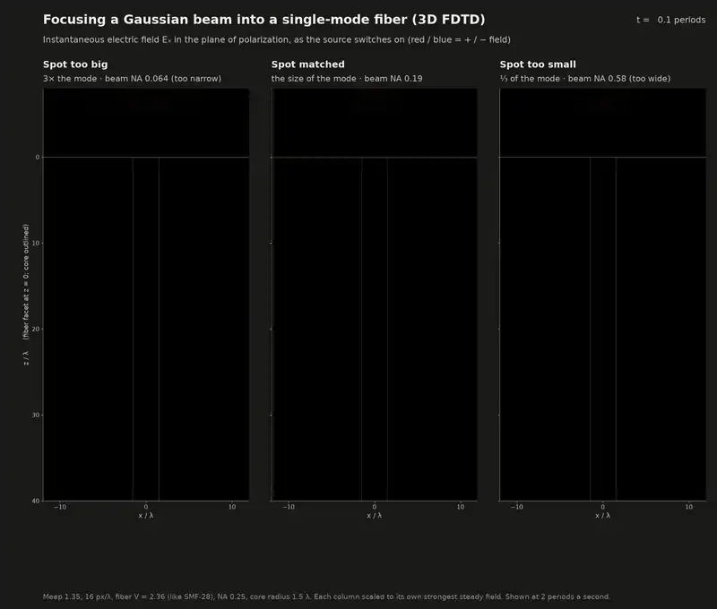</a>
  <br><sub>Full 3D Maxwell (FDTD) simulations of a focused Gaussian beam entering a cleaved single-mode
  fiber, for a spot on the fiber tip that is too big (launch NA too narrow), matched, and too small
  (launch NA too wide). The beam switches on, fills the
  fiber, and settles; then the picture changes to where the power ends up: <b>white</b> = the beam
  still in air, <b>blue</b> = light in the fiber's guided mode, <b>orange</b> = everything else
  (log scale, the same for all three rows). <a href="media/launch_movie.mp4">Full-resolution MP4</a>.</sub>
</p>

**Short answer.** It goes forward, into the cladding, and stays there for a surprisingly long
way. A launch NA that is too narrow is the same thing as a focused spot that is too big for the
fiber's mode. Only the part of the incoming field that has the mode's shape is guided: 38% for a
spot 3× too big. The rest (59%) is neither reflected nor scattered at the facet. It goes into the
glass as a broad beam around the core, almost all of it inside the core's acceptance cone, and
travels alongside the core without ever joining it. It leaks out through the fiber's coating only
slowly: in SMF-28 terms, half of it is gone after 6 mm, but a sixth of it is still in the cladding
after 3 cm, where a power meter at the end of a short pigtail will count it. A spot 3× too
*small* (launch NA too wide) loses about as much, but that light leaves at steep angles and is
gone within a few millimetres.

**In a single-mode metal waveguide** (fed through a horn, the way microwave guides are) the
answer is different, as it has to be: there is no cladding, so everything that does not end up
in the guide's one mode is reflected. A spot that is too big is mostly reflected by the metal
face around the horn's mouth. A spot that is too small goes into the mouth, but as the horn's
higher modes, and each of them turns back where the horn becomes too narrow for it
([below](#the-same-beams-into-a-single-mode-metal-waveguide)).

---

## Contents

- [The question](#the-question)
- [What the simulations show](#what-the-simulations-show)
- [The same beams into a single-mode metal waveguide](#the-same-beams-into-a-single-mode-metal-waveguide)
- [The numbers](#the-numbers)
- [More movies](#more-movies)
- [How it was computed](#how-it-was-computed)
- [How much to trust it](#how-much-to-trust-it)
- [Reproducing it](#reproducing-it)
- [Files](#files)

## The question

> When light entering a fiber isn't mode matched, not all of it gets launched down the fiber. If the
> incoming mode is too big, some of it gets into the cladding and fails to propagate. But what happens
> to the "rest" of the light when the NA into the fiber is too narrow?

## What the simulations show

### 1. "NA too narrow" and "spot too big" are the same thing

A focused Gaussian beam's waist and its divergence are locked together: w₀ = λ / (π · NA). Halve the
NA and the spot on the facet doubles. So a launch whose NA is too narrow puts a spot on the facet
that is bigger than the fiber's mode, which is exactly the "incoming mode is too big" case.

The fiber here (the same V number as SMF-28, see [below](#how-it-was-computed)) has a mode field
radius of 1.66 λ. The beam that matches it has NA 0.19, which is *less* than the fiber's NA of 0.25:
the NA on a fiber's data sheet is the acceptance cone of the core, not the divergence of its mode.
The figures and movies name each launch by its spot on the fiber tip: "spot too big" is the
launch whose NA is too narrow (NA 0.064, 3× narrower than matched, a spot 3× the mode); "spot too
small" is the launch whose NA is too wide (NA 0.58, 3× wider, a spot ⅓ of the mode).

<picture>
  <source media="(prefers-color-scheme: dark)" srcset="media/facet_profiles_dark.png">
  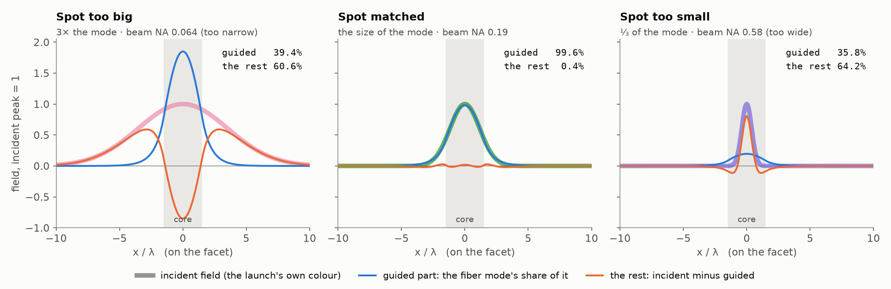
</picture>

Only the part of the incoming field that has the shape of the mode is guided (blue). "The rest" is
whatever is left over: the incident field minus the guided part (orange). For the matched launch
the two shapes agree and the rest is almost nothing (0.4%). The too-big spot is broader and
flatter than the mode, so its rest has a phase-inverted dip inside the core and two broad shoulders
out in the cladding. The too-small spot is a narrow spike, so its rest is the opposite: a sharp peak
on the axis with shallow inverted wings. The power lost is about the same for both (61% and 64%);
what differs is where the rest goes, and that is what the 3D simulations show.

### What each simulation covers

Two simulations work together, and they cover very different scales. The 3D FDTD solves
Maxwell's equations in full, but only for the first 120 λ of fiber (0.6 mm of SMF-28), and only in a
28 λ window around the axis that stops short of the cladding surface. The long-distance model
(BPM) picks up the 3D field 5 λ inside the facet and carries it 6000 λ (2.9 cm of SMF-28) through
the whole cladding and its coating. Even that is the first 3% of a 1 m patch cord. The figure
zooms out from the facet in four steps, each panel drawn as a box inside the next:

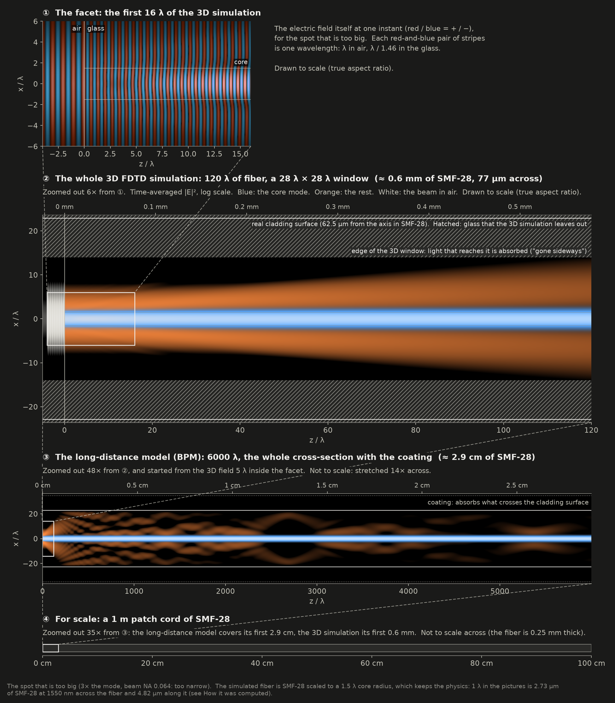

| | 3D FDTD (Meep) | long-distance model (BPM) |
|---|---|---|
| length of fiber | 120 λ ≈ 0.6 mm of SMF-28 | 6000 λ ≈ 2.9 cm of SMF-28 |
| cross-section | 28 λ × 28 λ ≈ 77 µm square, inside the 125 µm cladding | the whole 125 µm cladding and an absorbing coating |
| physics | full vector Maxwell: the facet, its reflection, light at every angle | scalar waves going forward, exact for every angle |
| what it answers | how the light splits at the facet, and where the uncoupled part starts out | where the uncoupled light ends up |
| cost per launch | about 3 hours on 16 cores | 2 to 13 minutes |

### 2. The rest keeps going forward, through the cladding, beside the core

The side view through the axis, once everything has settled. In all three launches the light that
is not in the mode keeps going forward. Almost nothing comes back: the 3% reflection is the plain
Fresnel reflection of the glass, about the same for every launch. What differs is the direction
the rest takes.

- **Spot too big (NA too narrow):** the rest leaves the facet as a broad beam, about 15 λ across, that widens only
  slowly and runs almost parallel to the core. 115 λ in, 57% of the incident power is still inside
  the 28 λ window around the core, and only 1.3% has left it.
- **Spot too small (NA too wide):** the rest leaves the facet as a spike that diffracts at steep angles, up to about 30°
  in the glass. Most of it crosses the edge of the 28 λ window between 25 and 100 λ: by 115 λ, 53% of
  the incident power has gone sideways and only 6% is still near the core.

The core carries the same 38% in both. The edge of the 3D window is not the edge of the fiber:
light that leaves the window is still in the cladding glass (see
[What each simulation covers](#what-each-simulation-covers)).

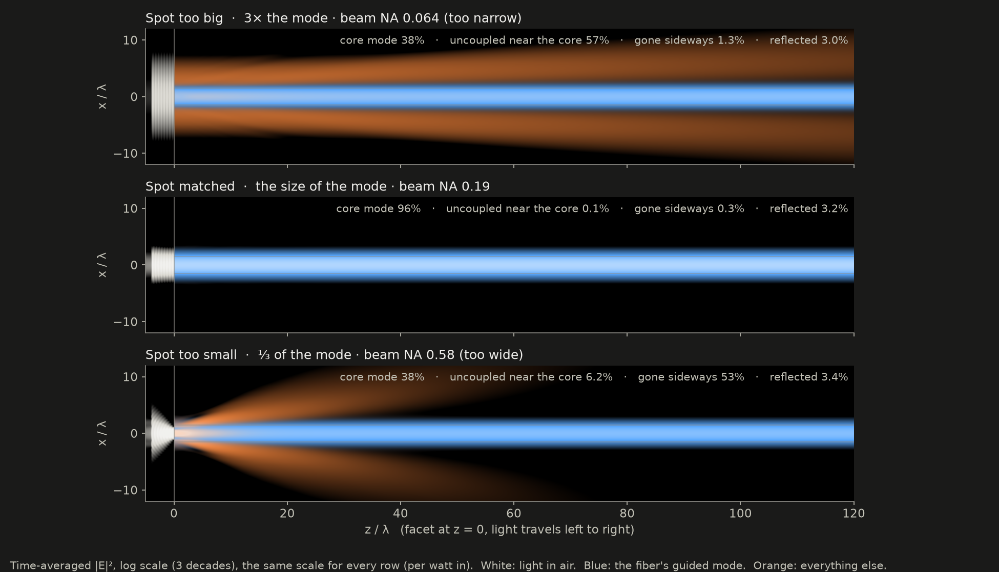

<picture>
  <source media="(prefers-color-scheme: dark)" srcset="media/budget_dark.png">
  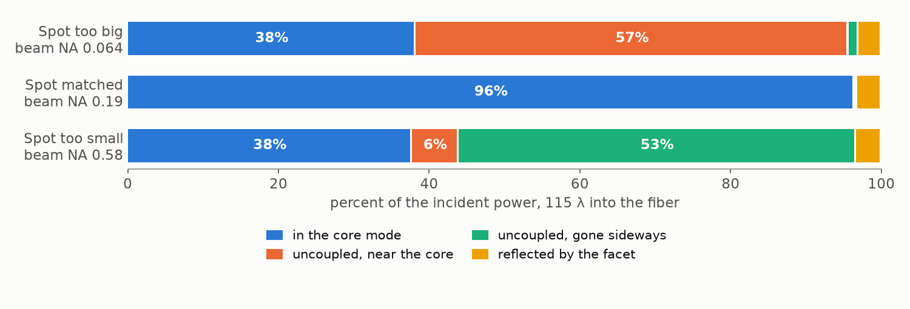
</picture>

### 3. It never joins the core later

The power in the core mode at every cross-section from the facet to the end of the fiber (blue),
and all the forward-going light inside the 28 λ window (orange). The guided power is flat to within
0.03% of the incident power: the uncoupled light runs alongside the core the whole way without
joining the mode, and nothing leaks out of the mode either. In a straight, uniform fiber the guided
mode and the rest are independent solutions of Maxwell's equations, and nothing moves power from
one to the other. The orange curve shows where the rest goes: for the too-big spot it hardly
drops; for the too-small spot it falls to 44% as the steep light leaves the window.

<picture>
  <source media="(prefers-color-scheme: dark)" srcset="media/power_along_z_dark.png">
  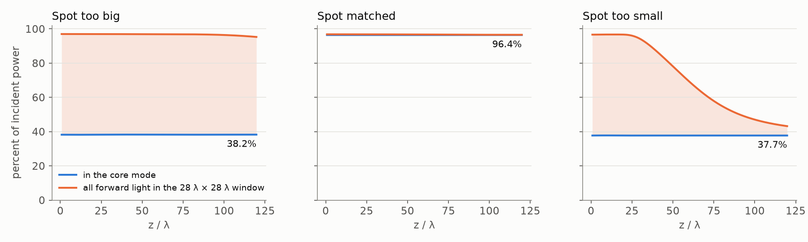
</picture>

### 4. It is inside the acceptance cone; it is just in the wrong place

The ray picture of a fiber says that light is guided if it lands on the core inside the acceptance
cone. The uncoupled light of the too-big spot passes the direction test: decomposed into plane
waves just inside the facet, 97% of it travels within the core's acceptance angle (9.9° in the
glass), and most of it within 3°. It is not guided because it has the wrong *shape*: a broad
ring around the core with a dip inside it, which is orthogonal to the mode. And because it travels
so nearly parallel to the axis, it takes a long way to reach the outside of the cladding. The
too-small spot is the opposite: 89% of its uncoupled light is outside the cone, at angles up to
about 30°.

<picture>
  <source media="(prefers-color-scheme: dark)" srcset="media/uncoupled_angles_dark.png">
  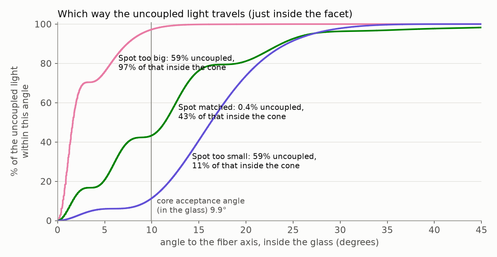
</picture>

### 5. Where it finally goes: out through the coating

Beyond 120 λ the long-distance model takes over. It includes the whole cladding (its surface is
22.9 λ from the axis in this scaled fiber; the 3D window ends at 14 λ) and an absorbing coating.
The uncoupled light of the too-big spot spreads slowly out to the cladding surface and is
absorbed by the coating a little at a time. Half of it is gone after 6.4 mm of SMF-28. At 2.9 cm,
the end of the run, 9% of the incident power is still in the cladding, falling by 1/e about every
2.5 cm: cladding modes, light at shallow angles that only grazes the coating now and then. The
uncoupled light of the too-small spot hits the coating at steep angles and is gone quickly: half
of it within 0.5 mm, 99% within 8 mm. In all three launches the guided power stays where the facet
put it (38%, 96%, 38%) the whole way.

<p align="center">
  <a href="media/long_distance.mp4">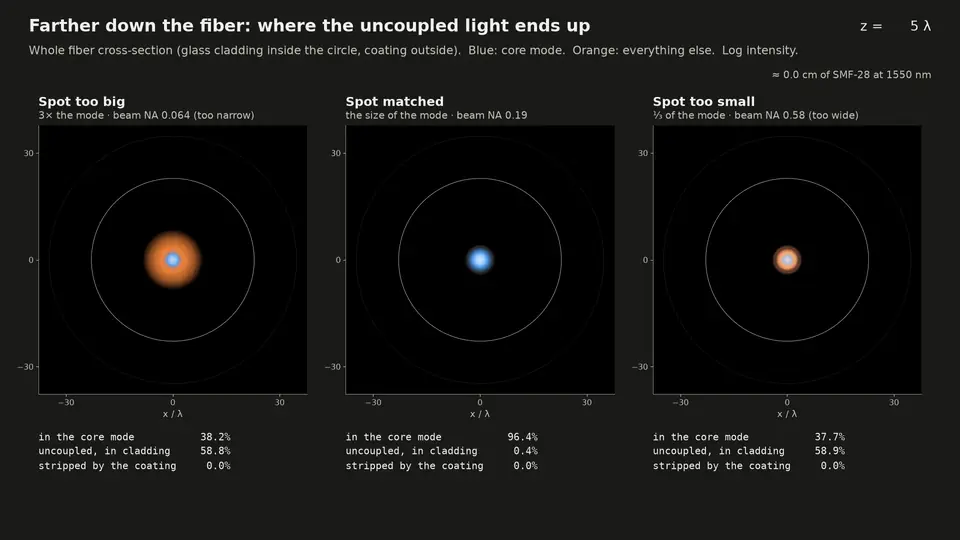</a>
</p>

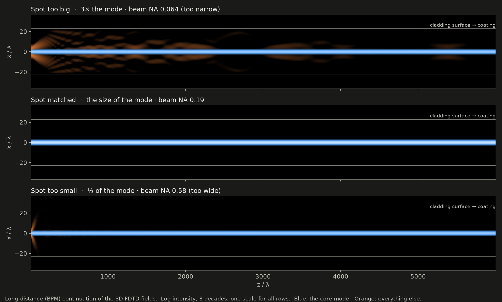

<picture>
  <source media="(prefers-color-scheme: dark)" srcset="media/long_distance_budget_dark.png">
  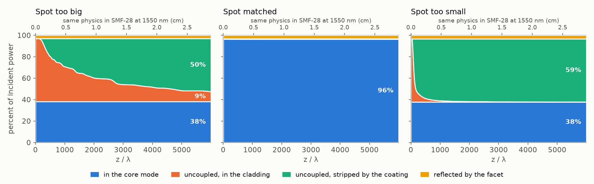
</picture>

### 6. Why ray optics gets this wrong

Coupling efficiency against beam NA. The solid curve is the usual wave-optics estimate: the
overlap of the Gaussian with the mode, times the Fresnel transmission of the facet. The dashed curve
is the same estimate without the paraxial approximation. It sends the exact focused beam through
the facet one plane wave at a time, with its own s and p Fresnel coefficients. The dots are the 3D
FDTD: the three launches above and six more NAs from a sweep into a short (10 λ) fiber. They
follow the exact focused-beam estimate to within 0.3% of the incident power at every NA; the
paraxial estimate falls short above NA 0.3 (by 3.5% at NA 0.77).

Ray optics (dotted) counts the power that lands on the core inside the acceptance cone. On the
low-NA, big-spot side it is far too pessimistic: 16% of a spot 3× too big lands on the core, but 38% couples.
The mode reaches past the core, and the overlap adds field amplitudes coherently, so light landing
just outside the core still contributes. The reverse lesson matters more: a launch NA well inside
the fiber's NA is no guarantee of coupling. At NA 0.064, a quarter of the fiber's NA, 59% of the
light is lost, as much as at NA 0.58, more than twice the fiber's NA.

<picture>
  <source media="(prefers-color-scheme: dark)" srcset="media/efficiency_vs_na_dark.png">
  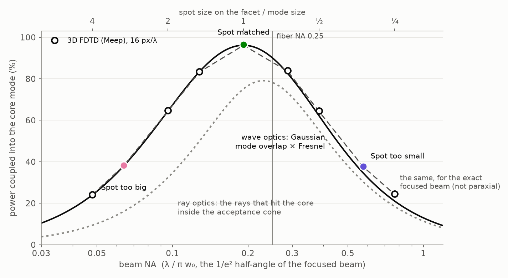
</picture>

### What this means at the bench

- **Spot too big (NA too narrow):** the light you lose is not reflected toward the source; that is only the usual
  3 to 4% Fresnel reflection of an uncoated facet, at any NA. It goes forward into the cladding as
  slow, shallow cladding modes and can last for centimetres. A power meter at the end of a short
  pigtail counts some of it, so the measured "coupling" reads high, then drops as the fiber gets
  longer or is bent. A cladding-mode stripper, or a few tight loops of fiber, removes it.
- **Spot too small (NA too wide):** about the same loss, but the uncoupled light leaves at steep angles and is gone
  within millimetres.
- **Matched:** the best beam NA is set by the mode field diameter, not the data-sheet NA. For
  SMF-28 at 1550 nm (mode field diameter 10.4 µm) that is λ / (π w₀) ≈ 0.095, against a quoted
  fiber NA of 0.14.

## The same beams into a single-mode metal waveguide

<p align="center">
  <a href="media/horn_movie.mp4">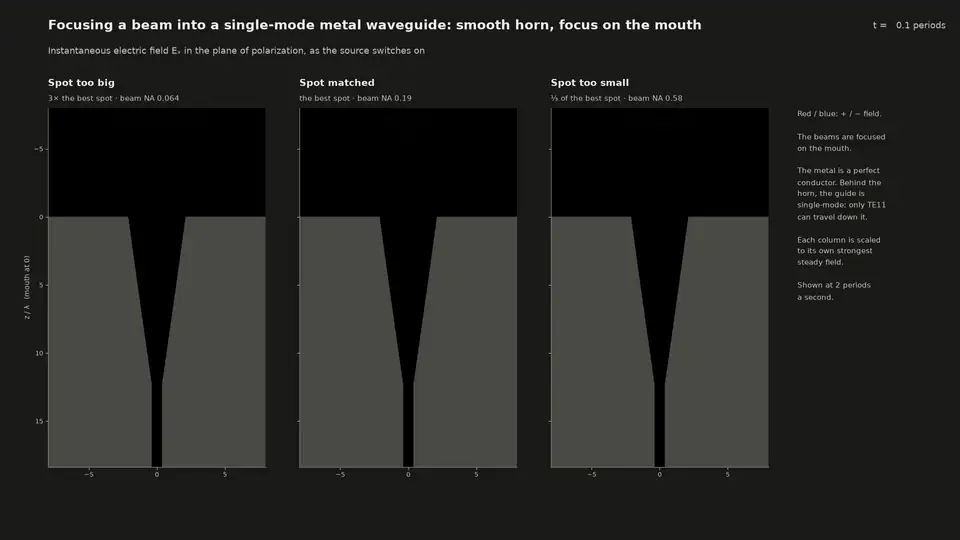</a>
  <br><sub>The same three beams, now focused onto the mouth of a horn that feeds a single-mode,
  perfectly conducting circular waveguide (full Maxwell equations; the light comes down from the
  top). The beam switches on, fills the horn and settles; then the picture changes to where the
  power ends up: <b>white</b> = the incident beam, <b>blue</b> = the guide's mode heading in,
  <b>yellow</b> = everything else, all of which ends up reflected.
  <a href="media/horn_movie.mp4">Full-resolution MP4</a>.</sub>
</p>

**Short answer for the metal guide.** It comes back. A perfectly conducting guide has no
cladding. Outside its mouth is the metal face; inside, light can only travel as one of the
guide's modes, and each mode only where the guide is wide enough for it. So light that does not
end up in the guide's one mode has nowhere to go but back the way it came, and the simulations
find exactly that: guided plus reflected is 100% to within 0.01%. What differs between
the launches is *where* the light turns back.

- **Spot too big:** most of it (70%) lands on the metal face around the mouth and is
  reflected right there, as from a mirror with a hole in it. 24% reaches the guide.
- **Spot too small:** nearly all of it goes into the mouth (99%), but as the horn's
  *higher* modes: a small spot is a wide cone of directions, and the horn carries steep
  directions in its higher modes. Each of those turns back where the horn becomes too narrow for
  it, and 75% of the incident power comes back out of the mouth. 24% reaches the guide.
- **Matched:** 80% reaches the guide. The 20% that does not is mostly higher modes
  too: the field a smooth horn makes at its mouth is close to a Gaussian, but not equal to one.

### Why a metal guide needs a horn

A metal pipe is single mode only while it is less than 0.77 λ across. Its fundamental mode,
TE₁₁, needs a radius of at least 0.293 λ, and the next mode (TM₀₁) starts at 0.383 λ. The guide
here has a radius of 0.36 λ. Its mode is smaller than any spot a beam can be focused to and a
different shape, so a beam is not focused straight onto a bare single-mode guide. Microwave
practice feeds it through a horn: a gradual taper that turns the guide's mode into a beam the
size of the horn's mouth. The horn here is a smooth cone cut into the face of a thick metal
block, with a half-angle of 8°, 12.4 λ long, opening from the guide's radius to 2.1 λ at the
mouth (about the size of the fiber's core, 1.5 λ). After it, 6 λ of the single-mode guide end in
an absorber, which stands for a matched load.

That size makes the horn's matched beam the same as the fiber's. The best Gaussian for this horn
has a waist of 1.60 λ (0.76 × the mouth radius, the usual rule for a smooth-walled horn), and
the fiber's matched beam (1.66 λ) couples within 0.1 percentage point as well. So the same three beams, focused on
the mouth instead of the facet, are matched, too big and too small for both.

**Where a mismatched beam comes from.** In a microwave receiver the converging beam comes from
a dish or a lens, with the horn at its focus. The size of the focused spot is set by the dish's
focal ratio f/D: a shallow dish (large f/D) sends a narrow cone and makes a big spot; a deep dish
(small f/D) sends a wide cone and makes a small spot. "Spot too big" is a horn that is too small
for its dish. Antenna engineers, who usually think of the same horn transmitting, call that loss
*spillover*: the horn's beam is wider than the dish, and part of it misses. "Spot too small" is a
horn that is too big, too directive, for its dish: transmitting, it lights only the middle of the
dish (*under-illumination*, or taper loss). A feed horn is designed for the compromise between
the two.

### Where the light goes

The steady state on the plane of polarization, with the same brightness scale for all three
(per watt in). Everything yellow ends up reflected: in front of the mouth it is the reflected
light itself; inside the horn it is everything except the guide's mode heading in.

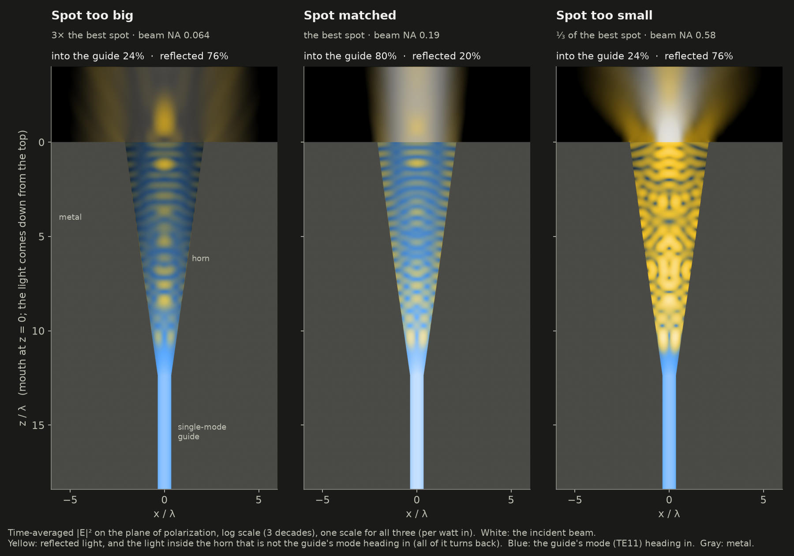

- **Spot too big:** the beam is 3× wider than the best spot and much wider than the mouth. The
  part that falls on the metal around the mouth is reflected straight back toward the source,
  and stands in front of the face as a wave pattern with the incident beam. The part that falls
  into the mouth is mostly the right shape, and most of it (24% of the incident power)
  reaches the guide.
- **Spot too small:** the whole spot fits into the mouth, so almost nothing hits the face. The
  light spreads into the horn at steep angles, fills it with a pattern of higher modes, and
  comes back out, leaving the mouth as a wide, rippled beam heading back toward the source.

### Inside the horn: each wrong mode turns back at its own cut-off

The horn is a waveguide whose radius shrinks, so at each depth its modes are those of a pipe of
that radius. At the mouth seven of them can carry light of this polarization (TE₁₁, TM₁₁, TE₁₂,
TM₁₂, TE₁₃, TM₁₃, TE₁₄). Each needs a minimum radius, its cut-off. As the horn narrows they
reach their cut-offs one after another (dotted lines), and there each mode's light stops and
turns around. Only TE₁₁ fits through the throat into the guide. Counting the power mode by mode
shows it. The too-small spot's light enters mostly in the higher modes (dashed). Their power
drops in steps at the cut-offs, and the light heading back out (solid yellow) drops in the same
steps, because what turns back at a cut-off travels back out of the mouth. TE₁₁ heading in
(blue) carries on to the guide, moving by a few points on the way, mostly near the cut-offs.
That is where the horn trades a little amplitude between its modes, and where counting modes on
caps is least exact. The horn converts at most 1.4% of TE₁₁'s power (sent out from the guide, TE₁₁
stays 98.6 to 99.8% TE₁₁), but a small amplitude converted into TE₁₁ adds to or cancels part of
TE₁₁'s own, and so moves its power by more than its own share.

<picture>
  <source media="(prefers-color-scheme: dark)" srcset="media/horn_modes_dark.png">
  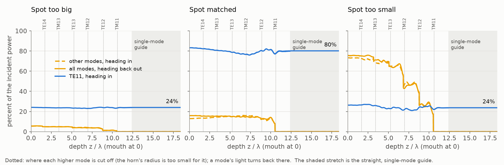
</picture>

### The fiber and the metal guide, side by side

<picture>
  <source media="(prefers-color-scheme: dark)" srcset="media/fiber_vs_horn_dark.png">
  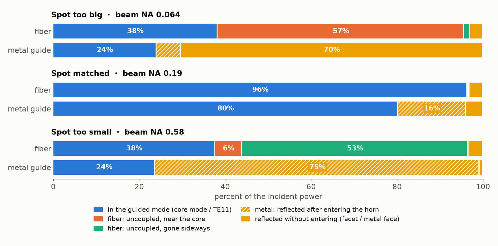
</picture>

| | single-mode fiber | single-mode metal guide, fed by its horn |
|---|---|---|
| what surrounds the mode | cladding: glass that carries light in any direction, just not guided | nothing that carries light: metal outside the mouth, and inside the horn only modes, each of which stops at its cut-off |
| where uncoupled light goes | forward into the cladding, then out through the coating | back the way it came: there is nowhere else |
| spot too big | 57% forward into the cladding, beside the core, lost slowly over centimetres | 70% reflected by the metal face around the mouth |
| spot too small | 59% forward at steep angles, out through the cladding within millimetres | 75% enters the horn in higher modes and turns back inside it |
| matched | 96% guided: only the Fresnel reflection is lost | 80% guided; 16% turns back inside the horn, because a smooth horn's mouth field is not quite Gaussian |
| reflected | 3 to 4% (the glass's Fresnel reflection), whatever the launch | everything that is not guided |

In both, the guided power is the overlap of the incoming field with the mode it has to match; the
coupling numbers themselves are of the same kind. What differs is what the rest can turn into. The
fiber offers the uncoupled light a continuum of forward-going states that are not guided, in the
cladding and beyond it, so it goes forward and leaks away to the side. A metal guide with
lossless walls offers nothing but its own modes, and below cut-off those carry no power, so the
only state left for the uncoupled light is the one it came in on, reversed.

Two consequences at the bench:

- **The guide never sees the mismatch.** The horn itself is well matched to the guide: TE₁₁ sent
  out of the guide has less than 0.1% of its power reflected back (a return loss better than
  30 dB). A network analyzer on the guide sees a good antenna. A badly focused beam shows up only as lost gain, with the
  missing power scattered back toward the dish and the source.
- **The fiber's loss can hide downstream; the metal guide's cannot.** A fiber's uncoupled light
  travels with the guided light for centimetres and can reach a detector. A metal guide's never
  enters the guide at all.

### How the metal guide was computed

**One plane is enough.** The horn, the guide and a beam on their axis are all symmetric about
that axis. An x-polarized beam with a round spot has fields that vary around the axis only as
cos φ and sin φ, which is exactly half angular order m = +1 and half m = −1, mirror images of
each other. Meep's cylindrical mode solves the full 3D Maxwell equations for one angular order
on the (r, z) plane, so it gives the exact 3D field at the cost of a 2D run: 120 grid points
per wavelength, 43 across the guide's radius, about 5 hours per launch on 5 cores. The
first version simulated the horn on a 3D Cartesian grid and could not converge. Meep cannot
smooth a perfect conductor below the pixel, so the cone's wall became a staircase, and the
staircase scattered TE₁₁ into other modes: the matched beam's coupling came out as 41, 55 and
69% at 16, 20 and 28 points per wavelength (`fiberlaunch/horn_cartesian.py`, kept for the
record).

**The box.** 16 λ in radius (14 λ inside the absorbers), from 7 λ in front of the mouth to the
end of the guide. The beam is the same exact Gaussian as in the fiber runs, here built from
plane waves in cylindrical components (`fiberlaunch/beam.py`). It enters through a plane of
equivalent electric and magnetic currents 4 λ in front of the mouth, which radiates it forward
only (3 × 10⁻⁵ of the power goes backward), and it is focused on the mouth.

**Accounting**, as fractions of the incident power (from a matching run with no metal):

| | how it is measured |
|---|---|
| reflected | 1 − (net flux through a plane in air 2 λ in front of the mouth) / (incident power), plus the light that skims out sideways along the face (through the side of the box between that plane and the face; at most 0.74%) |
| into the guide | the flux through the guide, 1 and 3 λ behind the horn |
| entered the horn, turned back inside it | the power heading back out in all the horn's modes just inside the mouth (below) |
| reflected by the face | reflected − (turned back inside the horn) |

**Counting modes in a horn.** The modes of a cone are spherical waves about its apex. On a
spherical cap centred on the apex, each mode has a uniform phase, and for a cone this narrow
its profile is that of a straight pipe whose radius is the cap's arc radius. So the field is
taken on such caps, one for every depth (on planes in the straight guide), and each mode's
power heading in and heading out comes from Lorentz reciprocity against the same mode heading
the other way, which separates the two directions exactly. Sent out from the guide, TE₁₁ is
recovered as 98.6 to 99.8% TE₁₁ on every cap at 120 points per wavelength.

**Checks.**

- *Energy:* guided + reflected = 100% to within 0.01% for all three launches, and the
  power heading down the horn is the same on every plane from the mouth to the guide.
- *Reciprocity:* the coupling also follows from one run in reverse: TE₁₁ sent out of the guide,
  its radiated field overlapped with each incoming beam in front of the mouth (Lorentz
  reciprocity; `scripts/horn_design.py`). At 120 points per wavelength that gives
  24.0%, 80.3% and 23.4%, against 24.0%, 80.2% and 23.7% from the direct runs.
- *Resolution:* the reverse runs at 20, 40, 60, 80 and 120 points per wavelength
  (`media/horn_design.txt`): the matched coupling is 44, 72, 78, 79 and 80%, converging as
  1/res² toward 81.2%; the too-small spot's toward 23.9%; the too-big spot's stays at 24.0 ±
  0.2% from 60 on. The direct runs at 120 are within 1 point of these converged values.
- *Theory:* the textbook estimate fills the mouth with the guide's mode (TE₁₁ for a pipe of the
  mouth's radius) on a spherical wavefront centred on the cone's apex. It gives 24.2%, 82.1% and
  24.9%, close to the simulation, so the horn behaves as the standard picture says.

## The numbers

All as percentages of the power the beam carries in air (`media/results.json`,
`media/horn_results.json`, `data/bpm/summary.json` once the simulations are run).

| | spot too big<br>(NA too narrow) | spot matched | spot too small<br>(NA too wide) |
|---|---:|---:|---:|
| beam NA (λ / π w₀) | 0.064 | 0.19 | 0.58 |
| spot radius w₀ on the facet | 4.98 λ | 1.66 λ | 0.55 λ |
| ***3D FDTD, 115 λ into the fiber*** | | | |
| reflected by the facet | 3.0 | 3.2 | 3.4 |
| in the core mode | **38.2** | **96.4** | **37.7** |
| uncoupled, near the core (in the 28 λ window) | 57.4 | 0.1 | 6.2 |
| uncoupled, gone sideways (out of the window) | 1.3 | 0.3 | 52.7 |
| ***long-distance model, 6000 λ (2.9 cm of SMF-28)*** | | | |
| in the core mode | 38.2 | 96.4 | 37.7 |
| uncoupled, still in the cladding | 9.3 | 0.02 | 0.1 |
| uncoupled, absorbed by the coating | 49.5 | 0.4 | 58.8 |
| ***theory for the coupling*** | | | |
| mode overlap × Fresnel (paraxial) | 38.0 | 96.1 | 34.6 |
| exact focused beam, plane wave by plane wave | 38.1 | 96.1 | 37.5 |
| ray optics × Fresnel | 16.0 | 75.1 | 30.3 |
| ***metal waveguide with its horn, FDTD at 120 px/λ*** | | | |
| into the guide's mode (TE₁₁) | **24.0** | **80.2** | **23.7** |
| reflected by the metal face around the mouth | 70.3 | 4.0 | 0.8 |
| entered the horn, turned back inside it | 5.7 | 15.8 | 75.4 |
| ***theory for the metal guide*** | | | |
| reciprocity (one reverse run), extrapolated to an infinitely fine grid | 24.0 | 81.2 | 23.9 |
| aperture theory (TE₁₁ on the mouth, spherical wavefront) | 24.2 | 82.1 | 24.9 |
| ***3D FDTD, extrapolated to an infinitely fine grid*** | | | |
| reflected by the facet | 3.4 | 3.6 | 3.8 |
| in the core mode | 38.0 | 96.0 | 37.4 |

## More movies

**In 3D.** A volume rendering of the steady state, each launch cut open along its axis, with the
camera moving from in front of the facets round to the side. Same colours as above; brightness is
log intensity on one scale for all three.

<p align="center">
  <a href="media/launch_3d.mp4">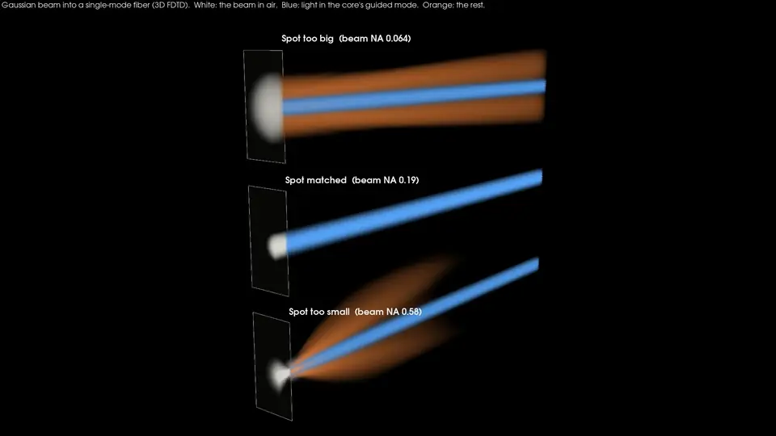</a>
</p>

**Flying down the fiber.** The cross-section of the fiber at each distance from the facet, from
the beam in air to the end of the 3D simulation, with the running power budget underneath.

<p align="center">
  <a href="media/cross_sections.mp4">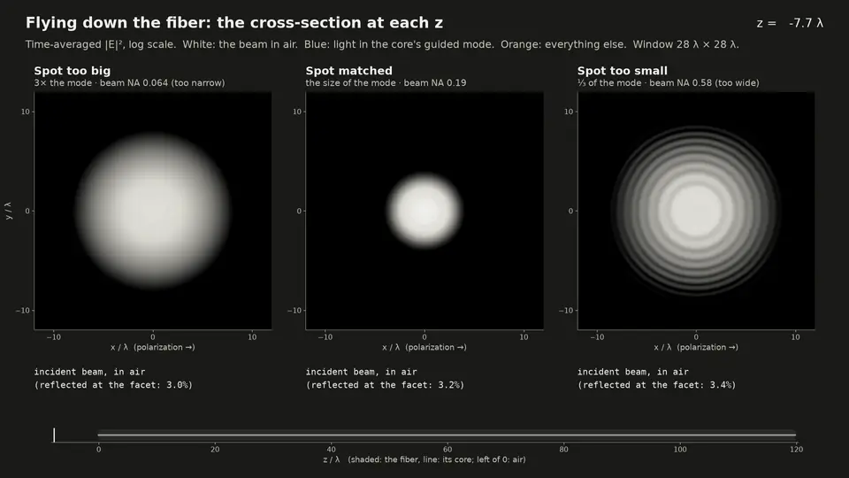</a>
</p>

## How it was computed

**The fiber.** A step-index fiber with the same V number as SMF-28 (V = 2.36, single mode),
in units of the wavelength: core radius 1.5 λ, NA 0.25, cladding index 1.45. A real SMF-28 core
is 4.1 µm at 1.55 µm, i.e. 2.6 λ with NA 0.14. This fiber is that one shrunk across by 1.76 and
with the NA raised by the same factor, which keeps the guided mode's shape (in units of the core)
and the coupling numbers exactly the same while cutting the 3D volume by about 10. Diffraction
lengths along the fiber shrink by 1.76² = 3.1; the "cm of SMF-28" axes undo that.

**The launches.** A Gaussian beam focused onto the cleaved facet from air, x-polarized, at
three NAs: a spot matched to the mode (waist 1.66 λ, NA 0.19), a spot 3× too big (waist 4.98 λ,
NA 0.064: too narrow) and a spot 3× too small (waist 0.55 λ, NA 0.58: too wide). "Beam NA" is λ/(π w₀), the 1/e² half-angle. The beam is
Meep's exact focused-beam source (a complex point source), not a paraxial approximation, which
matters for the too-small spot. At NA 0.58 the exact shape of a real focus depends on the lens;
this one is an exact solution of Maxwell's equations with the Gaussian's waist.

**3D FDTD** with [Meep](https://meep.readthedocs.io) 1.35: 16 grid points per wavelength
(11 per wavelength inside the glass), a 32 λ × 32 λ × 130 λ box including PML absorbers
(28 λ × 28 λ × 120 λ of fiber), 4-fold mirror symmetry, 16 MPI processes, about 3 hours per
launch. The source is a continuous wave that switches on smoothly; the run continues until
every part of the field inside the fiber has reached steady state, and then the field is
Fourier-transformed over 4 more periods on:

- a stack of cross-sections every 0.5 λ (all six field components),
- the two side planes through the axis,
- flux planes for the reflection and for the transmitted power.

**Splitting the light.** The guided part at each cross-section is the projection of the
FDTD field onto the fiber's HE₁₁ mode, computed by Meep on the same grid in a separate run so
that both share the same discretization:
a = [∫(E × h*) + ∫(e* × H)]·ẑ dA / 2∫(e × h*)·ẑ dA, so that |a|² is the guided power.
Everything else is "the rest". Meep's own eigenmode coefficients (MPB) agree to 0.05%.

**Accounting for the power**, as fractions of the power the beam carries in air (from a
matching run with no fiber):

| | how it is measured |
|---|---|
| reflected | 1 − (net flux through a plane in air between the source and the facet) / (incident power) |
| in the core mode | \|a\|² from the projection, fitted as A e^{iβz} over all the cross-sections |
| uncoupled, near the core | flux through the 28 λ × 28 λ cross-section at the end of the fiber, minus the guided power |
| uncoupled, gone sideways | the remainder: light that has crossed the edge of the 28 λ window (still inside a real 125 µm cladding) |

**Long distances.** 120 λ of fiber is only 0.6 mm of SMF-28. To follow the uncoupled light
until it is gone, the FDTD field 5 λ inside the facet is handed to a beam-propagation method
(`fiberlaunch/bpm.py`): a scalar split-step Fourier method with the exact (non-paraxial)
propagator in the glass, on the whole fiber cross-section: core, the full 125 µm cladding and
a higher-index, absorbing 190 µm coating, scaled like the core. It starts from exactly the
FDTD's guided / uncoupled split and runs to 6000 λ (2.9 cm of SMF-28) in 2 to 13 minutes. Over
the 110 λ where both exist, it agrees with the 3D FDTD on the guided power to 0.2% and on the
power left inside the 3D window to 2% of the incident power; the fields themselves correlate at
0.96, 1.00 and 0.94 for the three launches (the scalar model is least exact for the steep light of
the too-small spot).

**Theory**, for comparison (`fiberlaunch/fibermode.py`): the exact HE₁₁ mode of the step-index
fiber; the overlap of the incident Gaussian with the (scalar LP₀₁) mode; the Fresnel loss at the
facet; and the ray-optics estimate, which counts the rays that land on the core inside its
acceptance cone. Because the NA 0.58 beam is far from paraxial, there is also an exact version
of the overlap estimate (`exact_beam_coupling` in `fiberlaunch/analysis.py`): the FDTD's own
incident beam in air is split into plane waves, each is sent through the facet with its own s and
p Fresnel coefficients, and the transmitted field is projected onto the HE₁₁ mode.

## How much to trust it

- **Against theory.** The coupling the 3D simulation finds is within 0.5% (relative) of the exact
  focused-beam estimate for all three launches: 38.2% against 38.1%, 96.4% against 96.1%, 37.7%
  against 37.5%. The paraxial estimate is 9% low for the too-small spot, whose NA 0.58 beam is not paraxial.
  The FDTD's guided mode travels with n_eff = 1.46105 once the grid's known numerical dispersion
  is taken out; the exact HE₁₁ value is 1.46107.
- **Resolution.** The same launches into a 12 λ fiber at 10, 12, 16 and 20 points per
  wavelength (`media/convergence.txt`): from 16 to 20 the coupling changes by at most 0.15%
  of the incident power. Extrapolated to an infinitely fine grid (the error falls as 1/res²) it is 38.0%, 96.0% and 37.4%, within 0.2% of
  the exact focused-beam estimate. The facet's reflection converges more slowly: the 3.0 to 3.4%
  found at 16 points per wavelength extrapolates to 3.4 to 3.8%, close to the 3.5% Fresnel
  reflection of a plane wave at the mode's effective index. It is the only number here that
  the grid changes noticeably.
- **Energy.** The forward power 3 λ inside the facet equals the incident minus the reflected
  power to within 10⁻⁴, for all three launches: the facet loses no power that is not counted.
- **Steady state.** Sampled from the movie frames, the field amplitude anywhere along the
  fiber changes by less than 10⁻⁴ over the last 10 periods before the Fourier transform
  (`media/steady_state.txt`), and the guided power is the same at every cross-section from the
  facet to the end of the fiber (scatter at most 3 × 10⁻⁴).
- **The metal guide** has its own checks (energy, reciprocity, resolution, theory): see
  [How the metal guide was computed](#how-the-metal-guide-was-computed).
- **What is idealized.** A perfectly cleaved, uncoated facet at normal incidence, a straight
  fiber, a monochromatic continuous wave, a perfectly aligned beam, and a coating modelled as a
  uniform absorbing layer (real coatings have two layers and a rough outer surface; both strip
  cladding light faster). The fiber is scaled from SMF-28 as described above, which is exact
  for the coupling and for paraxial propagation, and close otherwise.

## Reproducing it

Everything is driven by `make` (Linux, about 23 hours on a 16-core desktop, about 15 GB of
raw data in `data/`, which is not in git):

```sh
make envs     # two conda environments: Meep (MPI) and PyVista (off-screen)
make sims     # 3D FDTD: the three launches, the NA sweep, the resolution study; then the BPM;
              # then the metal guide: its resolution study, and the three launches
make media    # figures, movies, the 3D render and the README previews
make test     # unit tests: the mode solver, the BPM, the exact-beam coupling estimate, the
              # exact beam in cylindrical components and the metal guide's modes
```

Individual pieces: `scripts/run_main.sh`, `scripts/run_sweep.sh`, `scripts/run_convergence.sh`,
`scripts/run_horn.sh`, and one run directly with
`mpirun -np 16 python -m fiberlaunch.fdtd --kind fiber --case narrow --movie --xy-planes` or
`mpirun -np 5 python -m fiberlaunch.horn --kind horn --case narrow --movie --out data/horn/res120/narrow`.
`scripts/env.sh` holds the settings (number of MPI processes, paths). On a machine with
InfiniBand or RoCE adapters, it also sets `UCX_TLS=self,sm,tcp` so the MPI library uses
shared memory instead of probing the adapters, which fails noisily without an unlimited
locked-memory limit.

## Files

| | |
|---|---|
| `fiberlaunch/params.py` | the fiber, the three launches, the box |
| `fiberlaunch/fdtd.py` | the Meep simulation (mode reference, incident beam in air, launch into the fiber) |
| `fiberlaunch/analysis.py` | mode projection, power accounting, guided / uncoupled split, exact-beam coupling |
| `fiberlaunch/fibermode.py` | analytic fiber mode, overlap, ray optics, Fresnel |
| `fiberlaunch/bpm.py` | the long-distance beam propagation |
| `fiberlaunch/horn.py` | the metal guide and its horn: Meep on the (r, z) plane (beam in air, launch into the horn, TE₁₁ sent out of the guide) |
| `fiberlaunch/beam.py` | the exact focused Gaussian beam in cylindrical components |
| `fiberlaunch/horn_analysis.py` | the metal guide's power budget, and the mode split on caps about the cone's apex |
| `fiberlaunch/horn_cartesian.py` | the first, 3D Cartesian horn, which could not converge (kept for the record) |
| `fiberlaunch/style.py` | colours shared by every figure and movie |
| `scripts/run_*.sh`, `run_bpm.py` | the simulation campaigns |
| `scripts/fig_*.py`, `movie_*.py`, `media_bpm.py`, `export_volumes.py`, `render_3d.py` | figures and movies (`fig_scales.py` draws the zoom-out) |
| `scripts/check_steady.py`, `summarize_convergence.py` | the steady-state and resolution checks |
| `scripts/horn_design.py`, `horn_media.py` | the metal guide: coupling of every beam by reciprocity and the resolution study; its figures and movie |
| `media/` | everything shown here, plus `results.json`, `horn_results.json`, `convergence.txt`, `horn_design.txt` and `steady_state.txt` |
| `tests/` | unit tests |
| `CLAUDE_CODE_CHAT.md` | the conversation with Claude Code that produced this |

## License

[MIT](LICENSE).
