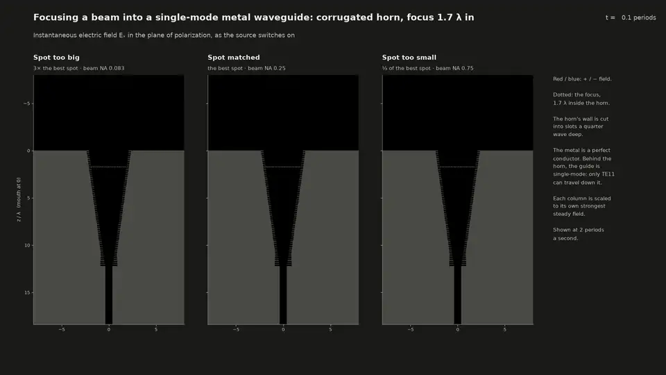
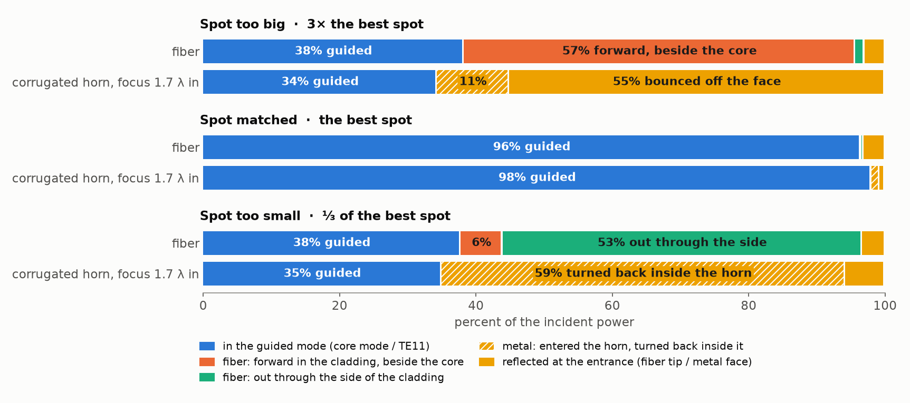

# Where does the light go when the launch NA into a single-mode fiber is too narrow?

Full Maxwell-equation (FDTD) simulations of a focused beam launched into a single-mode fiber, and
into a single-mode metal waveguide, with the spot at the entrance too big (launch NA too narrow),
matched, and too small (launch NA too wide).

  
   <b>Into a single-mode fiber</b>; the light comes down from the top. The beam switches
  on, fills the first 40 λ of the fiber and settles, shown at 2 periods a second and at its true
  shape (x and z to one scale); then the picture shows where the power ends up.
  White: the beam in air. Blue: the fiber's guided mode. Orange: everything else.
  <a href="media/launch_movie.mp4">MP4</a>

  
   <b>Into a single-mode metal waveguide</b>, fed through a corrugated horn as on radio
  telescopes; the light comes down from the top. The horn's mode is 98% Gaussian, the closest
  metal match to the fiber's, and the beams are focused 1.7 λ inside its mouth, where its own beam
  has its waist. Blue: the guide's mode. Yellow: everything else, all of which ends up reflected.
  <a href="media/corrugated_movie.mp4">MP4</a>. The same for a smooth horn, the fiber's beams
  focused on its mouth (<a href="media/horn_movie.mp4">MP4</a>) or 3.7 λ inside it
  (<a href="media/horn_focus_movie.mp4">MP4</a>).

## Where the light goes

<picture>
  <source media="(prefers-color-scheme: dark)" srcset="media/fiber_vs_corrugated_dark.png">
  
</picture>
The fiber's numbers are 115 λ (0.6 mm of SMF-28) past the tip. Further on, the coating
absorbs the light in the cladding. The full chart, with the smooth horn too, is in
[the study](STUDY.md#the-fiber-and-the-metal-guide-side-by-side).

- **In a fiber, the light that misses the mode goes forward into the cladding** and leaks out
  through the coating: over centimetres for a big spot, millimetres for a small one.
- **In a metal waveguide, all of it comes back**, because there is no cladding. A big spot bounces
  off the metal around the horn's mouth. A small spot gets into the horn, then turns back inside it.
- **"NA too narrow" is "spot too big".** Every beam here is a converging Gaussian focused on the
  entrance (or, in a horn, just inside it); only the spot's size changes, and its spread of angles with it: w₀ = λ / (π · NA).
  The spot 3× too big converges over 78 λ, so over the 8 λ simulated in front of the entrance it
  looks parallel ([the beams as launched](STUDY.md#1-na-too-narrow-and-spot-too-big-are-the-same-thing)).
- **Too big overfills the core; too small overfills the NA.** Most of a spot 3× too big lands
  beside the core, or on the metal around the horn's mouth, at angles that would be accepted. A
  spot 3× too small lands on the core, but spread over 3× the angles. The two lose about the same.
  The fiber holds only angles within its NA. The horn's walls reflect every angle, but each bounce
  off the narrowing cone steepens the light by 16°, so light steeper than about 10° turns back.
- **The corrugated horn is the metal guide most like the fiber.** Focus each beam where the
  guide's own beam has its waist: on the facet for the fiber, 1.7 λ inside the corrugated horn.
  Then only the spot's size differs, and the pattern is the fiber's: 34 / 98 / 35% into the guide
  for too big / matched / too small, against 38 / 96 / 38%
  ([why](STUDY.md#which-is-like-the-fiber)).

## In 3D, and further down the fiber

  
   The fiber launches rendered in 3D, cut open along the axis. <a href="media/launch_3d.mp4">MP4</a>

  
   Flying down the fiber, from the beam in air to 120 λ past the tip: the cross-section at
  each distance. A spot too small's uncoupled light spreads fast: by 100 λ, half of all the
  light has left the window sideways. A spot too big's stays near the core. <a href="media/cross_sections.mp4">MP4</a>

  
   Then the fiber's whole cross-section, out to 2.9 cm of SMF-28: the coating absorbs the
  light in the cladding (a spot too small's within the first second, a spot too big's over the
  whole run), and the guided mode carries on. <a href="media/long_distance.mp4">MP4</a>

## Details

How it was done, every number, the checks, and more figures: **[STUDY.md](STUDY.md)**. Built with
[Meep](https://meep.readthedocs.io); `make envs sims media` rebuilds everything (about 2½ days
on a 16-core desktop). Made with Claude Code: [the conversation](CLAUDE_CODE_CHAT.md).
[MIT license](LICENSE).
